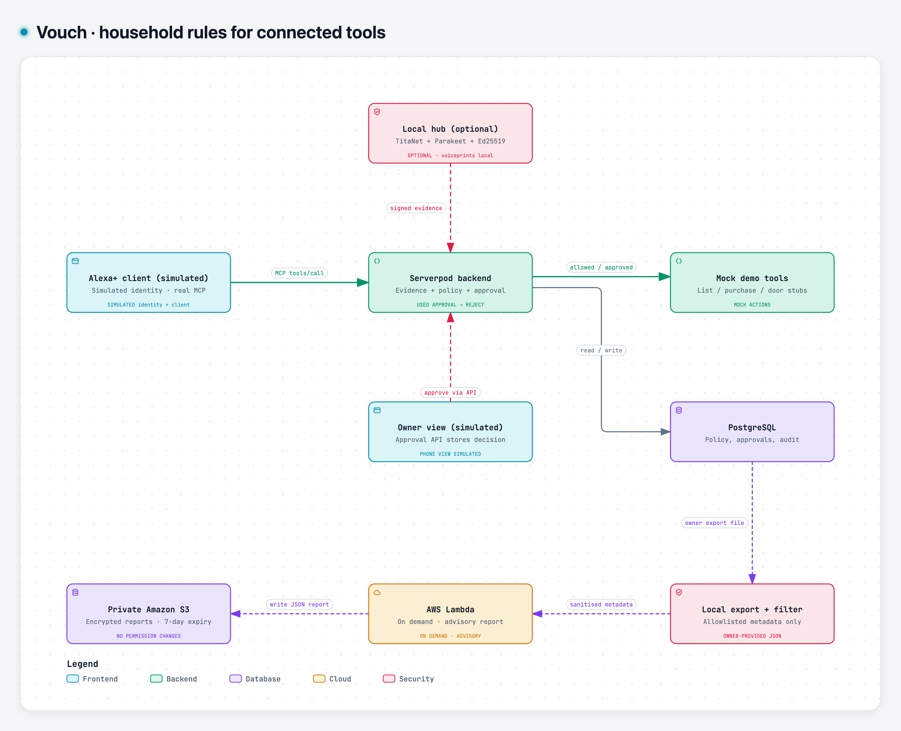

# Vouch

**Household rules for connected tools.**

Alexa already has purchase controls and parental approvals. Vouch explores request-bound household permissions for custom tools connected through its MCP server. It cannot intercept every native Alexa action.

A local Python hub can provide speaker evidence. The backend checks household policy and approval state before a connected tool runs. The no-hub demo simulates speaker identity and the owner-phone interface.

| Tier | Actions | Requirement |
|------|---------|-------------|
| **T0** | Weather, time, music | None |
| **T1** | Shopping list, calendar read | Recognised speaker, bound to this exact command |
| **T2** | Locks, purchases, messages | Recognised speaker **+** the owner's approval |

Rules are written in plain language — *"Ana can't buy anything over €10"* — and compiled
into policy by NVIDIA Nemotron. The owner confirms generated rules before they take effect. The prototype does not include a deepfake detector.

> Account linking and household permission checks answer different questions.

## Architecture



[Interactive diagram and source evidence](submission/architecture/README.md) · [SVG](submission/architecture/vouch-architecture.svg)

The demo client and owner-phone view are simulated, and connected actions are mock tools. The backend checks policy and approval state before execution. AWS reporting is a separate on-demand path over an owner-provided export; it cannot grant permissions. Source links in the interactive diagram are pinned to the reviewed commit.

Optional plain-language rule authoring through Nemotron on Nebius is described below and omitted from this overview.


**Voiceprints never leave the hub.** Serverpod stores references and metadata only.

## Fastest way to try it: no hub, no mic

Needs only the Dart/Flutter toolchain (no Python, no models, no microphone):

```bash
export PATH="$PATH:$HOME/.pub-cache/bin"
cd vouch && dart pub get
./vouch_server/tool/setup_passwords.sh
serverpod start
```

In the app, click **Try the demo household (no hub)**, open the **Alexa** tab and tap one of
the four scenario chips: *TV orders a PlayStation*, *Ana orders a PlayStation*, *Priya
unlocks the door*, *Reworded command*. Each one runs a real `tools/call` against the MCP
guard and shows the decision trace. (Speaker identification is simulated in this mode; the
guard, policy, approvals and audit log are the real ones.)

After a sensitive request is approved and completes, the Alexa tab offers
**Replay the used approval**. This resends the same approval continuation
without fresh voice evidence. The backend rejects the used approval and
the interface explains that the action was not repeated. The owner-phone
card is simulated; it is not a demonstration of approval on a separate
authenticated device.

## Quickstart (with the hub)

Prerequisites: Dart 3.12.2 / Flutter, Node 22, Python 3.12 (`/opt/homebrew/bin/python3.12` on
macOS Homebrew, `python3.12` on Linux; newer system Pythons are too new for NeMo's dependencies), an [HF_TOKEN](https://huggingface.co/settings/tokens)
and a [Nebius Token Factory](https://docs.nebius.com/studio/inference) API key.

```bash
export PATH="$PATH:$HOME/.pub-cache/bin"   # required for the `serverpod` command
```

**1. Server + admin app.** `vouch/` is a Dart workspace (don't flatten it — `pubspec.yaml`
lists `vouch_client`, `vouch_server`, `vouch_flutter` as members):

```bash
cd vouch
dart pub get
```

`vouch_server/config/passwords.yaml` is gitignored (it holds real secrets) and is **not**
in a fresh clone. Create it from the committed template before starting the server or
running server tests:

```bash
./vouch_server/tool/setup_passwords.sh   # copies config/passwords.example.yaml, fills random secrets
```

The script never overwrites an existing file. It leaves `nebiusApiKey` as a placeholder:
put your Nebius Token Factory key there to enable plain-language rule compilation (Rules tab)
and unknown-tool classification. Without it those two calls fail with an error message and
everything else (pairing, the demo household, the MCP guard, approvals, activity) works.
Then, still inside `vouch/`:

```bash
serverpod start
```

This starts an **embedded PostgreSQL** (no Docker), generates code, and launches
both the API server (port 8080; web/MCP route on 8082) and the Flutter admin app. First run
downloads the embedded Postgres binary, so it needs network access once. The CLI prints
`Can't load Kernel binary: Invalid kernel binary format version` before every command — this
is cosmetic, ignore it.

**2. Hub (Python speaker ID + ASR).** In a separate terminal:

```bash
cd hub
/opt/homebrew/bin/python3.12 -m venv .venv   # Linux: python3.12 -m venv .venv
.venv/bin/pip install torch --index-url https://download.pytorch.org/whl/cpu
.venv/bin/pip install -r requirements.txt
export HF_TOKEN=...   # https://huggingface.co/settings/tokens
./demo.sh setup       # generates hub keys, a demo household (Priya + Ana), synthetic voices, enrolment
```

**3. Pair the app to the hub:**

```bash
./demo.sh pair   # prints a 6-digit code, valid 10 minutes
```

Open the Flutter app (it signs in anonymously with no UI, then shows "Pair with your hub"),
enter the code.

**4. Run the demo:**

```bash
./demo.sh
```

## What each scene shows

1. **Ana (12) tries to order a PlayStation.** Recognised speaker, but a child can't place
   orders under the household's rules, so it's denied and the owner sees why in Activity.
2. **Priya unlocks the front door.** Recognised owner, but locks are T2 — she gets a step-up
   approval on her "phone" (simulated via `demo.sh`'s `approve`), then the tool call proceeds.
3. **Someone replays that same approval.** The attestation was already consumed — replay is
   rejected, not silently re-authorised.
4. **An unrecognised voice.** No enrolled match → denied, then a T0 command (weather) from the
   same unrecognised voice succeeds, since T0 needs no recognition at all.

## How Alexa+ is demonstrated

Amazon's Alexa+ add-on tools are partner-only (per the hackathon FAQ), so the **Alexa tab in
the Flutter app is a simulated Alexa+ client** that drives our real MCP server (`/mcp`,
Streamable HTTP, spec revisions 2025-11-25 and 2026-07-28) with real `tools/call` requests,
real MRTR `input_required` elicitation round-trips, and a live decision-trace panel. Nothing
about the MCP guard itself is simulated — only the ASR-and-dispatch layer Amazon doesn't let
third parties plug into during the hackathon.

## How we use NVIDIA models on Nebius

| Model | Where it runs | What it does |
|-------|---------------|--------------|
| `nvidia/speakerverification_en_titanet_large` | Hub (local, MPS) | Speaker verification — determines if a voice is recognised and enrolled. |
| `nvidia/parakeet-tdt-0.6b-v2` | Hub (local, MPS) | ASR — transcribes what was said on the microphone. |
| `nvidia/nemotron-3-super-120b-a12b` | Nebius Token Factory | Compiles plain-language household rules (e.g. *"Ana can't buy over €10"*) into structured policy before the owner confirms them. |
| `nvidia/NVIDIA-Nemotron-3-Nano-30B-A3B` | Nebius Token Factory | Classifies unknown tools into trust tiers (T0/T1/T2) when no explicit rule matches. |

- Every rule compiled by Nemotron Super is validated server-side (`RuleCompiler.validate`) before any policy takes effect.
- The owner explicitly confirms every compiled rule (`RuleCompiler.confirm`) — plain-language input never becomes active policy unreviewed.
- The nightly review (`jobs/nightly_review/`) is packaged as a Nebius Serverless Job (container + `deploy.sh`) that uses Nemotron Super to summarise unusual audit-log patterns; Nebius Jobs have no built-in schedule, so a nightly trigger comes from an external scheduler.

## Limits

- **Anti-spoofing is a signal slot, not a boundary, and no detector ships yet.** The hub has
  a pluggable scorer that can only ever *lower* trust; the default is a labelled placeholder.
  We do not claim to detect
  deepfakes. Voice cloning is the stress test, not the premise: a clone can copy a voice but
  not the owner's phone, which is why every T2 action needs tap-to-approve on the owner's
  phone. We never use shared-household trivia as a challenge.
- **Alexa+ may paraphrase, so a loose match never allows anything on its own.** A command is
  bound to a speaker only when Alexa's text matches the hub's transcript closely (similarity
  ≥ 0.90 **and** every number/amount identical). A near-miss (0.70–0.90, same numbers) keeps
  that member's rules, but anything above T0 goes to the owner's phone for approval. No
  match at all means an unrecognised speaker: only T0 is allowed. Real Alexa+ paraphrasing
  could not be measured, because Amazon's add-on tools are partner-only.
- **Accuracy numbers so far are synthetic** (generated demo voices, not real speakers) — see
  [`hub/README.md` § Measuring accuracy](hub/README.md#measuring-accuracy) for the FAR/FRR/EER
  harness and how to produce real numbers from recorded audio.

## Repo layout

```
vouch/                   Dart workspace root (Serverpod 4 fullstack scaffold)
  vouch_server/          Backend — identity, policy, attestation, audit, MCP guard
  vouch_client/          Generated Dart client
  vouch_flutter/         Flutter admin app
hub/                     Python — mic, VAD, TitaNet + Parakeet, attestation signing, demo.sh
jobs/nightly_review/     Standalone Nebius Serverless Job — nightly audit summary via Nemotron
oss/utterance-attest/    Extracted sign/verify/match library (Dart + Python), MIT
submission/              Public architecture, demo screenshots, developer feedback and AWS evidence
```

## Tests

```bash
# Server (unit + integration; needs config/passwords.yaml above; no Docker needed —
# Serverpod manages its own embedded test Postgres)
cd vouch/vouch_server && dart test

# Flutter admin app
cd vouch/vouch_flutter && flutter analyze && flutter test

# Hub
cd hub && .venv/bin/python -m pytest -q          # -m "not live" skips tests needing a running server

# utterance-attest (standalone library)
cd oss/utterance-attest/dart && dart pub get && dart test
cd oss/utterance-attest/python && python3.12 -m venv .venv && .venv/bin/pip install -e ".[test]" && .venv/bin/python -m pytest
```

## Status

Core flows (pairing, rules, attestation, MCP guard, approvals, audit, owner revoke/restore)
work end to end via `demo.sh` and via the no-hub demo household in the app. Accuracy numbers
are still synthetic, and no anti-spoof detector ships yet (see Limits).

## Licence

MIT

The reusable signing and transcript-matching component, Vouch Attest, lives
in [`oss/utterance-attest/`](oss/utterance-attest/README.md) in this repository.

## Optional AWS audit review

The audit-review job includes a verified AWS Lambda + S3 provider. It
reviews minimised audit metadata for repeated denials and unknown-speaker
sensitive requests, then saves a private report with seven-day expiry.
See [AWS setup, verification, privacy, and costs](jobs/nightly_review/AWS.md).
Reports are advisory and cannot authorise tool calls.

An optional Amazon Bedrock provider also exists, but account restrictions
still prevent successful inference; it is not part of the verified AWS claim.
